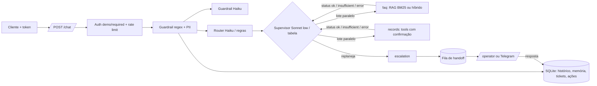

# {{NOME DO PROJETO}}

{{Uma frase: o que o sistema faz e para quem.}}

| | |
|---|---|
| Rodar | `docker compose up -d --build` → `http://localhost:8000/docs` · console do operador em `/operator` |
| Testar | `python scripts/check.py --docker --scale` (lint, testes, eval com gate, build, imagem sem extras, smoke do container, 2 réplicas atrás de balanceador) |
| CI | {{badge/link do último run verde}} |
| Vídeo | [walkthrough na página de Releases](../../releases/tag/video) (MP4 + legendas; narração por IA a partir do roteiro do autor, telas e números reais) |

## 0. Resultado em uma tela

Cada número que pesa na avaliação, com a meta e o status. **Os que estão abaixo da meta ficam aqui, não escondidos.**
Gerado por `scripts/fill_readme.py` a partir de `evals/results/` commitado (o `check.py` reprova divergência).
Tabelas completas, com intervalo de confiança por split: [docs/RESULTS.md](docs/RESULTS.md). Respostas reais dos
cenários oficiais: [docs/DEMO.md](docs/DEMO.md). O que veio do kit: [docs/PROCEDENCIA.md](docs/PROCEDENCIA.md).

<!-- scorecard:begin -->
<!-- scorecard:end -->

{{2–4 linhas: o que mudou da medida antes para a depois das correções feitas no relógio (docs/JUDGE_DIFF.md), e
por que cada métrica abaixo da meta está abaixo.}}

## 1. Como rodar

```bash
cp .env.example .env                      # opcional: sem chave roda no modo offline determinístico
docker compose up -d --build
curl -s localhost:8000/health
TOKEN=$(python -m app.auth u1)            # token de desenvolvimento assinado para o usuário u1
curl -s -X POST localhost:8000/chat -H "Authorization: Bearer $TOKEN" \
     -H "Content-Type: application/json" -d '{"message":"Qual o prazo de entrega? E onde está meu pedido 1002?"}'
```

- **Identidade:** `AUTH_MODE=required` (só Bearer; padrão do compose) ou `demo` (aceita `user_id` do corpo, marca
  `identity_verified=false`, rate limit por IP), ligado só pelo override
  `docker compose -f docker-compose.yml -f docker-compose.demo.yml up` para o payload literal `{"message","user_id"}`.
  Decisão em [docs/adr/0001-auth-mode-demo.md](docs/adr/0001-auth-mode-demo.md). JWT com `kid` e chaves rotacionáveis
  (`AUTH_KEYS`: HS256, EdDSA, RS256; públicas em `GET /.well-known/jwks.json`; `python -m app.auth keygen`).
- **Vários hosts:** `DATABASE_URL=postgresql://...` troca o SQLite por Postgres atrás da mesma interface
  ([ADR 0003](docs/adr/0003-postgres-opcional.md)); `docker compose --profile postgres up -d --build postgres api-pg
  lb-pg` sobe 2 réplicas sem arquivo compartilhado; `scripts/pg_replicas_smoke.py` prova com 2 processos.
- **Operador humano:** `/operator` (token digitado na página, nunca embutido), `GET /handoffs`,
  `POST /handoffs/{id}/reply` com `X-Operator-Token`. A resposta entra como evidência (agente `human`) e os passos
  pendentes do plano rodam na hora. Fila por especialidade (`OPERATOR_SKILLS`, `PUT /operators/{nome}/skills`); SLA
  vencido re-roteia para qualquer operador. Ação com limite de valor (`RISK_POLICY` do domínio, `RISK_LIMITS`). Opcional: Telegram (`TELEGRAM_*` no `.env`) avisa o caso e aceita
  `/responder T-xxxx texto` pelo webhook `/telegram/webhook`.
- **Ao vivo:** `powershell -File scripts/live_eval.ps1 -MaxUsd 3` (eval por split com teto de US$,
  juiz e README). Extras opcionais fora da imagem: `.[hybrid]` (busca híbrida) e `.[otel]` (OpenTelemetry).

## 2. Arquitetura



{{Por que essa divisão: uma fonte de verdade por agente; contrato em src/app/schemas.py.}}

## 3. Cobertura da régua de avaliação

Mapa para quem avalia **lendo**: código, teste que prova e onde está o número. Os números vêm dos
blocos da §5, gerados de `evals/results/` por `scripts/fill_readme.py`. Todo caminho em crase desta
seção existe: `tests/test_evidence.py` falha se um sumir. Reproduzir tudo: `python scripts/check.py --docker`.

| Critério | O que foi feito | Código | Prova | Número | Limite conhecido |
|---|---|---|---|---|---|
| Business & Challenge Fit (8%) | {{cenários do enunciado → split `official`; KPI do negócio que o sistema move}} | `src/app/tools.py` | `evals/cases.jsonl` | §5 Offline e Ao vivo, `official` | {{o que não cobre e por quê}} |
| Agentic Reasoning & Orchestration (15%) | Supervisor LLM com agentes como tools, lê `insufficient`/`error` e replaneja; tabela PLANS/FALLBACK/ALLOWED/MAX_STEPS; agentes independentes em paralelo | `src/app/supervisor.py` | `tests/test_supervisor.py::test_llm_reads_insufficient_and_replans_to_escalation`, `tests/test_supervisor.py::test_llm_disallowed_transition_is_refused`, `tests/test_parallel.py::test_independent_agents_run_in_parallel_in_plan_order` | §5 Replanejamento, splits `replan` e `parallel` | {{o que não cobre e por quê}} |
| ↳ Router (faz parte de Agentic Reasoning & Orchestration) | Haiku com JSON schema e few-shot dinâmico (8 exemplos mais parecidos); regra por frase + k-NN de n-gramas no offline; seguimento pela última fala com assunto; teste que reprova frase do held-out copiada para regra | `src/app/router.py` | `tests/test_router.py::test_llm_failure_falls_back_to_rules`, `tests/test_router_knn.py::test_unseen_paraphrase_goes_to_right_intent`, `tests/test_router_followup.py::test_follow_up_skips_acknowledgement`, `tests/test_router_contamination.py::test_detector_catches_v3_leak` | §5 Offline, `intent_acc` | {{o que não cobre e por quê}} |
| Context, Knowledge & RAG (10%) | BM25, híbrido (RRF) ou denso (fastembed) e cross-encoder local, **escolhidos por medida** (`run_evals --choose-retriever --apply`, MRR dentro de um teto de latência, portão calibrado por configuração); tabelas inteiras e rotuladas no ingest; quase-duplicatas fora do índice; "sem fonte, sem afirmação"; **todo número da resposta conferido contra fonte, tool e pergunta** (sem LLM; `unsupported_numbers` na resposta) | `src/app/rag.py`, `src/app/grounding.py` | `tests/test_rag.py::test_compare_retrievers_reports_both`, `tests/test_retrieval_v51.py::test_choose_by_mrr_within_latency_budget`, `tests/test_retrieval_v51.py::test_gate_is_calibrated_per_retriever_with_both_thresholds`, `tests/test_ingest.py::test_table_rows_keep_their_column_labels`, `tests/test_agents.py::test_faq_llm_not_in_sources_is_insufficient`, `tests/test_grounding.py::test_pipeline_flags_invented_number_and_counts_it`, `evals/retrieval.jsonl` | §5 Offline e Retrieval (Recall@3, MRR, nDCG@3, por URL, latência), `numbers_acc` | {{o que não cobre e por quê}} |
| Tool & Action Engineering (10%) | JSON Schema, identidade do servidor, escrita com confirmação do dono; **risco alto com aprovação de operador (quatro olhos)**; ação pendente expira (TTL); execução única entre réplicas; **servidor MCP em `/mcp`** (ask, search_knowledge, crm_tool; JWT obrigatório) | `src/app/actions.py`, `src/app/tools.py`, `src/app/mcp_server.py` | `tests/test_mcp.py::test_crm_tool_identity_comes_from_token_and_write_needs_confirmation`, `tests/test_mcp.py::test_anonymous_gets_401_before_the_protocol`, `tests/test_agents.py::test_tool_identity_is_server_side`, `tests/test_hitl.py::test_high_risk_action_needs_owner_then_operator_and_runs_once`, `tests/test_hitl.py::test_pending_action_expires`, `tests/test_memory_and_handoff.py::test_claim_is_atomic` | §5 Offline, `tools_acc` | {{o que não cobre e por quê}} |
| Security & Identity (13%) | JWT HS256 com `exp`/`iss`/`aud`/`jti` e revogação; operador com chave pessoal (auditoria); rate limit no SQLite que falha fechado; `AUTH_MODE` required/demo; guardrails regex + Haiku com desofuscação e injeção indireta; PII mascarada na entrada, no log e na saída | `src/app/auth.py`, `src/app/guardrails.py` | `tests/test_identity.py::test_expired_token_is_rejected`, `tests/test_identity.py::test_revoked_token_is_rejected_via_api`, `tests/test_identity.py::test_rate_limit_fails_closed`, `tests/test_guardrails.py::test_obfuscated_injection_is_caught`, `tests/test_guardrails.py::test_poisoned_document_is_dropped_at_load`, `docs/adr/0001-auth-mode-demo.md` | §5 Offline, split `guardrail` | {{o que não cobre e por quê}} |
| Memory, State & Resilience (8%) | Histórico em SQLite (WAL, vários processos) com **resumo rolante** além da janela; memória de longo prazo por usuário; queda do LLM cai no determinístico | `src/app/store.py`, `src/app/pipeline.py` | `tests/test_memory_and_handoff.py::test_history_survives_restart`, `tests/test_analytics.py::test_rolling_digest_keeps_early_facts_beyond_the_window`, `tests/test_identity.py::test_sqlite_survives_concurrent_writers`, `tests/test_agents.py::test_records_llm_failure_uses_deterministic_path`, `tests/test_runtime_store.py::test_two_replicas_escalating_the_same_conversation_open_one_ticket`, `scripts/scale_smoke.py` (conversa continua entre 2 réplicas, réplica cai e o atendimento segue) | §5 Offline, split `memory` | {{o que não cobre e por quê}} |
| Human Oversight & Risk Management (7%) | Fila persistida e console; **a resposta do operador retoma a conversa na hora**; aprovação de ação de risco; SLA com re-escalonamento único; Telegram ida e volta | `src/app/resume.py`, `src/app/api.py`, `src/app/notify.py` | `tests/test_hitl.py::test_operator_reply_resumes_the_conversation_immediately`, `tests/test_hitl.py::test_overdue_case_is_escalated_once`, `tests/test_hitl.py::test_two_simultaneous_replies_only_one_wins`, `tests/test_notify.py::test_reply_from_telegram_resumes_conversation` | §5 Offline, `handoff_acc` | {{o que não cobre e por quê}} |
| Evaluation & Quality Engineering (14%) | Gate offline no CI; ao vivo por split com teto de US$; `--repeat N` (pass^k, instáveis); juiz calibrado (kappa, TPR/TNR); checagem numérica sem LLM; matriz de falhas; limiar do portão por medida | `evals/run_evals.py`, `evals/judge.py`, `src/app/grounding.py` | `tests/test_evals.py::test_gate_passes_in_process`, `tests/test_evals.py::test_calibration_reports_tpr_tnr`, `tests/test_evals.py::test_repeat_reports_pass_hat_k_and_unstable_cases`, `tests/test_rag.py::test_gate_threshold_is_chosen_by_measurement`, `tests/test_eval_isolation.py::test_each_case_starts_without_memory_of_other_cases`, `tests/test_eval_judge_evidence.py::test_live_rows_record_tool_calls_sources_and_evidence`, `tests/test_eval_language_ci.py::test_detects_language_of_the_text`, `evals/judge_calibration.jsonl` | §5 Offline, Ao vivo e Juiz | {{o que não cobre e por quê}} |
| Observability, Reliability & Cost (6%) | Log JSON com `trace_id` e status de cada agente; US$ e tokens por request; `/metrics`; **alertas Prometheus provisionados**; `/analytics` (resolução, custo por resolvido, 👍/👎); OTel por env | `src/app/observability.py`, `src/app/analytics.py`, `ops/alerts.yml` | `tests/test_agents.py::test_cost_per_request_from_price_table`, `tests/test_alerts.py::test_alert_rules_are_valid_and_actionable`, `tests/test_analytics.py::test_every_request_is_logged_and_feedback_is_owned`, `tests/test_otel.py::test_console_exporter_emits_span_linked_to_trace_id` | §5 Ao vivo, `cost_usd` e p95 | {{o que não cobre e por quê}} |
| Production Engineering (5%) | Dockerfile multi-stage não-root, base fixada por digest com Dependabot, extra opcional embutido (`EXTRAS=hybrid`), lockfiles, smoke do container e **2 réplicas atrás de balanceador** no CI; scripts em bash e PowerShell | `Dockerfile` | `scripts/check.py`, `.github/workflows/ci.yml`, `.github/dependabot.yml`, `requirements.lock`, `requirements-hybrid.lock`, `scripts/live_eval.sh` | link do CI no topo | {{o que não cobre e por quê}} |
| Engineering Judgment (4%) | Decisões com a alternativa descartada; limitações declaradas | `docs/adr/0001-auth-mode-demo.md` | §4 e §9 deste README | — | {{o que não cobre e por quê}} |

## 4. Decisões e trade-offs

| Decisão | Alternativa descartada | Motivo |
|---|---|---|
| Supervisor LLM com tabela determinística como fallback | só LLM / só tabela | replan inteligente ao vivo; CI e falha do provedor seguem determinísticos |
| Agentes independentes em threads | asyncio | os agentes fazem I/O síncrono (SQLite, SDK); threads cortam o p95 sem reescrever a pilha |
| Effort por papel (supervisor low, agentes medium) | um effort global | o supervisor só escolhe o próximo passo; quem redige com fonte precisa de mais |
| Retriever escolhido por `--choose-retriever` (BM25 sem arquivo) | embeddings ou rerank por LLM sempre ligados | modelo pesado só entra com ganho de MRR medido, dentro do teto de latência e com o portão recusando os sem fonte |
| SQLite atrás de `Store` | Postgres/Redis | sobe com um comando; a troca para réplicas fica isolada num módulo |
| {{...}} | {{...}} | {{...}} |

## 5. Perguntas da entrevista, respondidas

As perguntas que a correção anterior deixou para a entrevista, respondidas com o número medido nesta entrega.

| Pergunta | Resposta curta | Onde está a prova |
|---|---|---|
| Quais respostas oficiais o juiz reprova, e por quê, se intenção e ferramentas acertam? | {{causas por caso, antes × depois}} | `docs/JUDGE_DIFF.md` |
| O rerank tem ganho medido? Por que está (ou não) no caminho? | {{tabela bm25 × híbrido × rerank, latência}} | `evals/results/retrieval_compare.json` |
| Onde a memória perde informação? | {{memória × roteamento, separados}} | §0 e `docs/RESULTS.md` |
| Quanto do kit foi escrito depois das correções anteriores? | {{resposta direta, com a tabela do git}} | `docs/PROCEDENCIA.md` |
| Como medir o ganho do replanejamento em perguntas reais? | {{split de perguntas reais de lojistas, com e sem}} | `evals/results/ablation_replan*.json` |

## 6. Procedência e linha do tempo

O primeiro commit traz um kit próprio, que **evoluiu a partir das correções das entregas anteriores deste desafio**
(histórico por versão em [docs/KIT_CHANGELOG.md](docs/KIT_CHANGELOG.md)). O relógio mede a especialização para este
enunciado, não o esforço do motor genérico: [docs/PROCEDENCIA.md](docs/PROCEDENCIA.md) explica o que cada parte mede
e como comparar pela primeira entrega.

<details><summary>Linha do tempo (git log)</summary>

<!-- timeline:begin -->
<!-- timeline:end -->

</details>

## 7. Limitações e próximos passos

- {{o que é simulado}}
- {{cada métrica abaixo da meta do §0, com a causa e o próximo passo}}
- {{o que ficou de fora e por quê; o que não rodou no relógio}}
