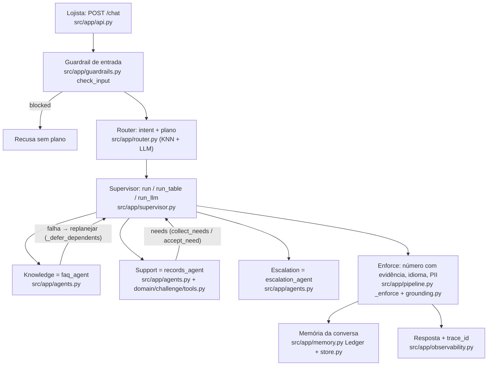
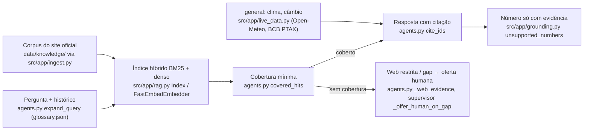

# Arquitetura — Getnet Support Agents (v5)

Descreve só o que o motor (`src/app/*.py`, congelado) faz. A spec é `docs/SPEC.md`; o domínio do desafio fica em
`src/app/domain/challenge/` (`flow.py`, `tools.py`) e `src/app/domain/challenge_prompts/`.

## 1. Agentes e supervisor



- `pipeline.handle` → `_guard_and_route` → `supervisor.run`. O supervisor executa o plano em lotes (`next_batch`,
  `run_batch`; `multi` roda faq ∥ records), aceita `needs` pedidos por um agente (`collect_needs`, `accept_need`),
  e numa falha adia os dependentes e replaneja (`_defer_dependents`, `next_step`). Ablação por `SUPERVISOR_REPLAN`
  (`on`, `no_needs`, `off`).
- Condição de parada por turno: `MAX_MODEL_CALLS`, `MAX_TURN_USD`, `NODE_TIMEOUT_S` (`budget_exceeded`,
  `_invoke_timed`). Estourou → entrega o já respondido e abre caso humano (`_exhaust`).

## 2. RAG e dados ao vivo (Knowledge)



- O buscador é escolhido por medida (`run_evals --choose-retriever`, `data/retriever.json`; ADR 0004).
- `general` nunca abre caso; número de clima/câmbio só vem da API com data (`live_data.py`).

## 3. Escritas com confirmação e humano no laço (HITL)

```mermaid
sequenceDiagram
  participant L as Lojista
  participant SP as records_agent (agents.py)
  participant A as actions.py run_tool
  participant RK as risk.py classify
  participant OP as Operador (/operator, api.py)
  participant RS as resume.py
  L->>SP: "contesta a TX1006"
  SP->>A: open_dispute(args) — identidade do servidor (auth.py)
  A->>RK: classify (risk high)
  A-->>L: pendente: confirmar? (action_id, expira)
  L->>A: POST /actions/{id}/confirm (confirm_action)
  alt exige aprovação humana
    A->>OP: fila (POST /actions/{id}/approve | reject → decide_action)
  end
  Note over SP,OP: escalation_agent abre handoff (store.py); operador responde em /handoffs/{id}/reply
  OP->>RS: resume_after_human retoma o plano salvo (_save_pending)
  RS-->>L: resposta com a decisão do humano
```

- Nenhuma escrita roda sem confirmação explícita; ação expirada não executa (`actions._expired`).
- SLA do handoff: `api.sla_check` / `POST /handoffs/sla-check`; notificação em `src/app/notify.py`.
